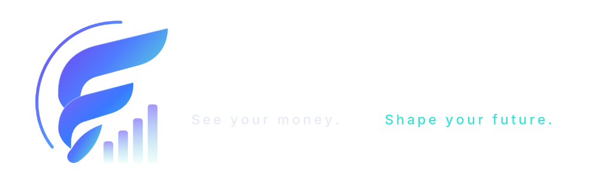
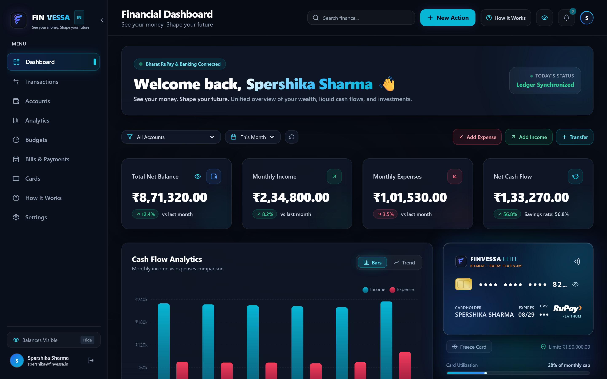
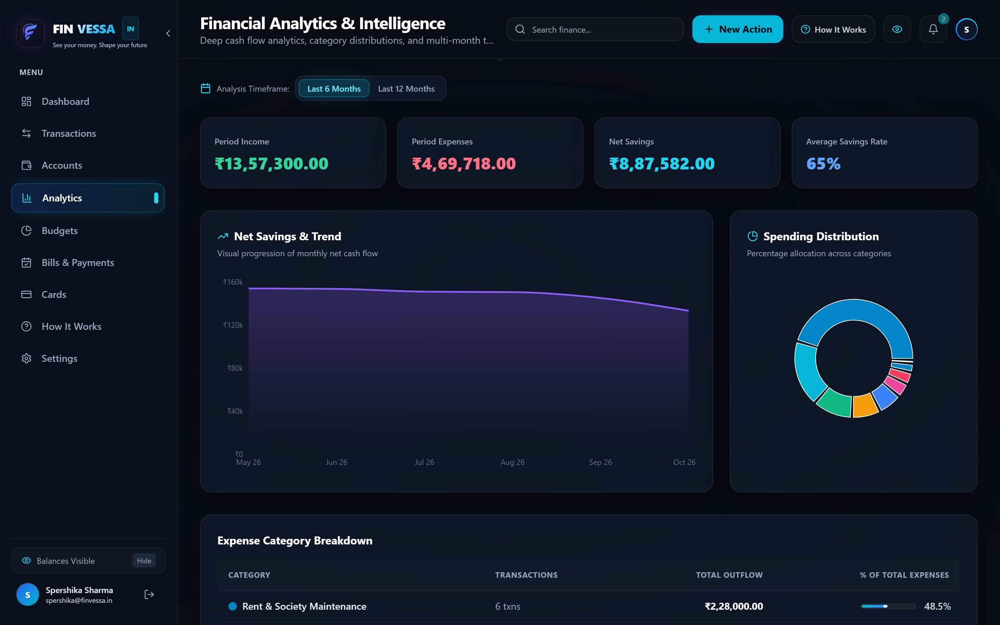
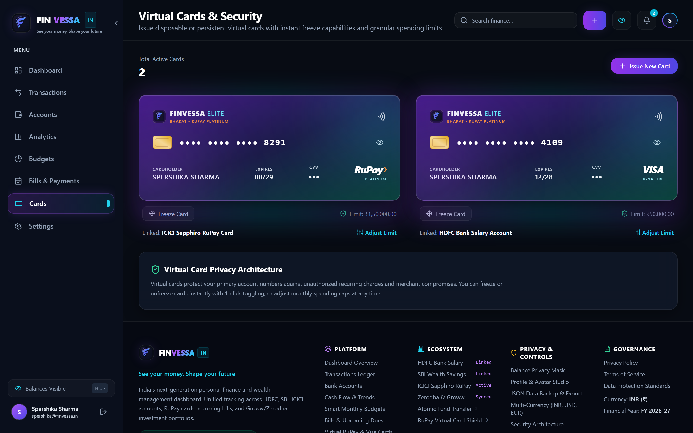
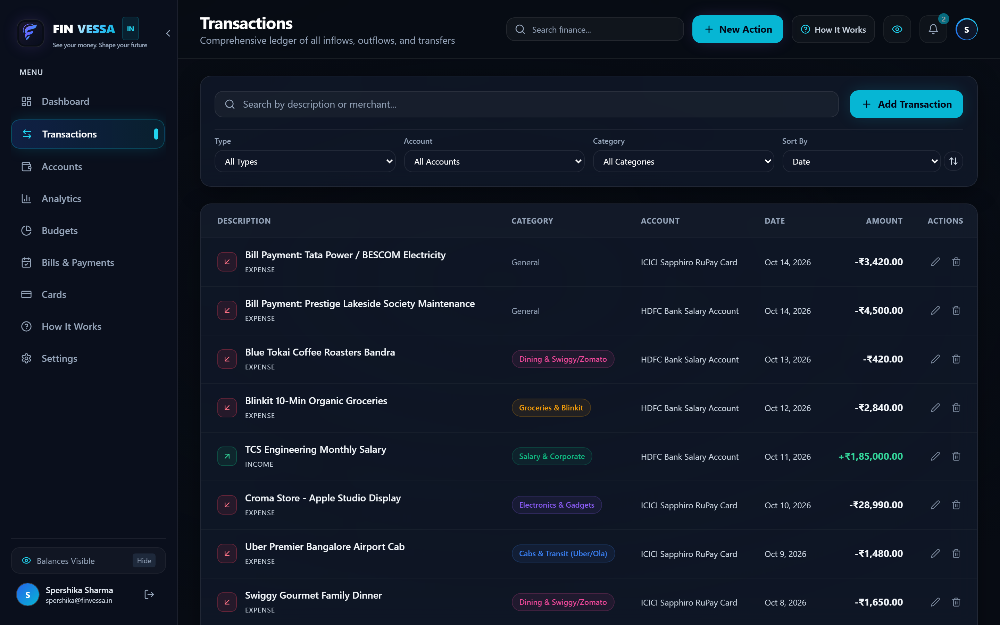
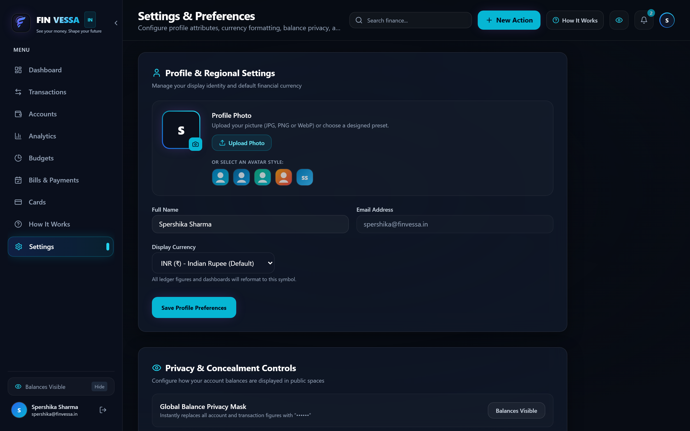
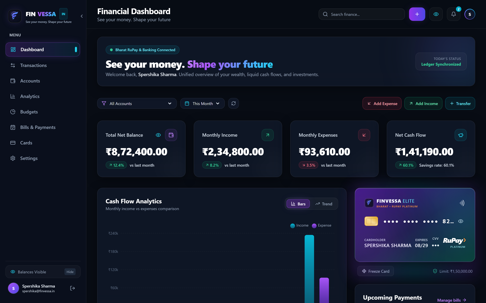

<div align="center">

  

  # ⚡ FINVESSA
  ### *See your money. Shape your future*

  **Next-Generation Personal Finance, Wealth Intelligence & Double-Entry Ledger for India and Global Citizens**

  <p align="center">
    <a href="https://nextjs.org"></a>
    <a href="https://www.typescriptlang.org"></a>
    <a href="https://tailwindcss.com"></a>
    <a href="https://www.prisma.io"></a>
    <a href="https://sqlite.org"></a>
    <a href="https://framer.com/motion"></a>
    <a href="https://vitest.dev"></a>
  </p>

  <p align="center">
    <a href="#-overview--vision">Overview</a> •
    <a href="#-visual-tour--screenshots">Visual Tour</a> •
    <a href="#-key-features">Key Features</a> •
    <a href="#-technical-architecture">Tech Stack</a> •
    <a href="#-financial-math--security">Financial Math</a> •
    <a href="#-getting-started">Getting Started</a> •
    <a href="#-license--copyright">License</a>
  </p>

</div>

---

## 🌟 Hero Showcase

<div align="center">
  
  <p><em>FINVESSA Executive Dark Glassmorphism Dashboard with Indian RuPay / Visa Cards, Multi-Bank Balances, and Real-Time Ledger Analytics</em></p>
</div>

---

## 💎 Overview & Vision

**FINVESSA** is an enterprise-grade personal wealth and cash-flow management platform designed with an obsidian-dark glassmorphism aesthetic, cyan and violet luminous accents, and strict financial accounting principles.

Engineered specifically around modern Indian banking (HDFC Bank, State Bank of India, ICICI Bank, and Zerodha/Groww investment portfolios), FINVESSA combines high-performance UI engineering with atomic double-entry ledger safety:

- **100% Exact Minor Currency Arithmetic**: Zero floating-point rounding errors. All ledger math executes in integer minor units (*paise* / *cents*).
- **Atomic Double-Entry Bookkeeping**: Cross-account transfers run inside ACID database transactions with debits and credits mathematically guaranteed to remain balanced.
- **Privacy Shield Mode**: One-click global concealment masks all figures to `••••••` across every card, table, chart, and header for discreet use in public spaces.
- **Personalized Avatar Studio**: Device photo upload with browser-side canvas compression alongside curated vector SVG avatar styles.
- **Enterprise Regulatory Footer**: Complete Indian banking ecosystem indicators, live system health, and interactive legal compliance modals.

---

## 📸 Visual Tour & Screenshots

### 1. Executive Financial Dashboard (`/dashboard`)
> Complete financial snapshot featuring real-time net cash flow, savings rate calculation, income vs. expense analytics, RuPay virtual card preview, and upcoming payment alerts.

<div align="center">
  
</div>

<br />

### 2. Deep Cash Flow & Category Analytics (`/analytics`)
> Interactive Recharts data visualizations including 6/12 month spending trends, category donut distributions, and savings velocity metrics.

<div align="center">
  
</div>

<br />

### 3. RuPay & Visa Virtual Cards Studio (`/cards`)
> Holographic virtual cards with 3D perspective tilt, embossed cardholder typography (*Spershika Sharma*), one-click card freeze/unfreeze, and monthly authorization limits.

<div align="center">
  
</div>

<br />

### 4. Real-Time Transaction Ledger (`/transactions`)
> Double-entry ledger with instant search, multi-account and category filters, date sorting, and server-side pagination with atomic balance reversal on edits and deletions.

<div align="center">
  
</div>

<br />

### 5. Settings, Avatar Studio & Privacy (`/settings`)
> Profile management, camera file picker with HTML5 canvas image scaling, vector avatar presets, global privacy mask toggle, and JSON data export.

<div align="center">
  
</div>

<br />

### 6. Public Landing Showcase (`/`)
> High-converting homepage introducing FINVESSA's core pillars, trust badges, and direct demo access.

<div align="center">
  
</div>

---

## 🚀 Key Features

| Module | Features & Capabilities |
| :--- | :--- |
| **Executive Dashboard** | Real-time Net Cash Flow, Savings Rate (60.1%), Monthly Income vs. Expenses, Spending by Category, Upcoming Dues, and Quick Actions. |
| **Transaction Ledger** | Add/edit/delete transactions, search by keyword, filter by account/category/type (`INCOME`, `EXPENSE`, `TRANSFER`), and atomic balance syncing. |
| **Bank Accounts** | Multi-account tracking (HDFC Salary, SBI Wealth Savings, ICICI RuPay, Zerodha/Groww), and atomic cross-account transfers. |
| **Financial Analytics** | Recharts dual-gradient bar chart, smoothed cash flow area charts, category pie breakdown, and historical trend filters. |
| **Smart Budgets** | Monthly category caps, real-time expenditure utilization meters, and visual warning badges at 80% and 100%+ thresholds. |
| **Bills & Dues** | Recurring bills calendar (SIPs, rent, utilities), overdue detection, and 1-click settlement recording expense transactions. |
| **Virtual Cards** | ICICI Sapphiro RuPay & HDFC Millennia Visa, masked card numbers, CVV reveal, live freeze/unfreeze, and monthly spend cap configuration. |
| **Avatar Studio** | Device image file picker with automatic 256×256 canvas compression, 5 vector SVG presets, and global avatar synchronization. |
| **Privacy Shield** | Global concealment eye replaces all sensitive monetary amounts with `••••••` across all views. |
| **Comprehensive Footer** | Banking ecosystem links, live uptime indicator, Indian pride mark, and interactive modals for Privacy, Terms, and Security. |

---

## 🛠 Technical Architecture

```
finvessa/
├── src/
│   ├── app/                      # Next.js 14 App Router
│   │   ├── (auth)/login, signup  # Authentication routes
│   │   ├── dashboard/            # Executive dashboard
│   │   ├── transactions/         # Double-entry ledger
│   │   ├── accounts/             # Multi-account management
│   │   ├── analytics/            # Recharts cash flow analytics
│   │   ├── budgets/              # Smart budget utilization
│   │   ├── bills/                # Scheduled recurring bills
│   │   ├── cards/                # Virtual RuPay & Visa cards
│   │   ├── settings/             # Preferences & Avatar Studio
│   │   └── api/                  # Secure RESTful API endpoints
│   ├── components/
│   │   ├── cards/                # Holographic 3D Virtual Cards
│   │   ├── charts/               # Recharts cash flow & category charts
│   │   ├── dashboard/            # Metrics summary cards & widgets
│   │   ├── layout/               # Header, Sidebar, Drawer, and Footer
│   │   ├── modals/               # Quick Actions & Transaction forms
│   │   └── ui/                   # Reusable buttons, inputs, toasts
│   ├── context/                  # AuthContext, CurrencyContext, SidebarContext
│   └── lib/                      # Prisma client, JWT auth, integer math
├── prisma/
│   ├── schema.prisma             # Relational data models
│   └── seed.js                   # Indian banking test dataset (Spershika Sharma)
├── scripts/
│   ├── test-api.js               # Full integration test suite
│   └── capture-screenshots.js    # Automated headless Edge screenshot runner
└── public/
    └── screenshots/              # High-definition Retina visual assets
```

### Technology Highlights
- **Framework**: [Next.js 14](https://nextjs.org/) (App Router, Server Components & Route Handlers)
- **Language**: [TypeScript 5.6](https://www.typescriptlang.org/) (Strict typing across all layers)
- **Styling**: [Tailwind CSS 3.4](https://tailwindcss.com/) with obsidian glassmorphic design tokens
- **Animations**: [Framer Motion 14](https://framer.com/motion) for smooth card renders and page transitions
- **Database**: [SQLite](https://sqlite.org/) (Zero-configuration local default) / [PostgreSQL](https://www.postgresql.org/) ready via [Prisma ORM 5.21](https://www.prisma.io/)
- **Icons**: [Lucide React](https://lucide.dev/)
- **Charts**: [Recharts 2.13](https://recharts.org/)
- **Testing**: [Vitest 2.1](https://vitest.dev/) (Unit tests) + Custom HTTP live verification suite

---

## 🧮 Financial Correctness & Security

### 1. Integer Minor-Unit Math (`paise` / `cents`)
All amounts in the database are stored as **integers** representing minor currency units (₹1.00 = `100` paise). This completely eliminates floating-point representation anomalies like `0.1 + 0.2 = 0.30000000000000004`.

```typescript
// Example: Converting user input to authoritative database paise
const amountMinor = Math.round(parseFloat(inputString) * 100);

// Formatted display
const formatted = new Intl.NumberFormat("en-IN", {
  style: "currency",
  currency: "INR",
}).format(amountMinor / 100);
```

### 2. Atomic Transfers
Cross-account transfers use Prisma's `$transaction` API:
```typescript
await prisma.$transaction(async (tx) => {
  await tx.account.update({ where: { id: fromId }, data: { balance: { decrement: amount } } });
  await tx.account.update({ where: { id: toId }, data: { balance: { increment: amount } } });
  await tx.transaction.create({ data: { type: "TRANSFER", ... } });
});
```

### 3. Authentication & Cookie Sessions
- Passwords are salted and hashed using **bcrypt** (10 salt rounds).
- Sessions are maintained with signed **JWT tokens** delivered via **`httpOnly`**, **`SameSite=Lax`** secure cookies.

---

## ⚡ Getting Started

### 1. Prerequisites
- **Node.js**: v18.0.0 or later (tested on Node v20 & v24)
- **npm**: v9.0.0 or later

### 2. Clone & Install
```bash
git clone https://github.com/Ankitcore/FinVessa.git
cd FinVessa
npm install
```

### 3. Setup Database & Seed
Initialize the SQLite database with the Indian banking dataset:
```bash
# Push schema migrations
npx prisma db push

# Seed accounts, cards, transactions, and Spershika Sharma demo user
node prisma/seed.js
```

### 4. Run Development Server
```bash
npm run dev
```
Open **[http://localhost:3000](http://localhost:3000)** in your browser.

### 5. Production Build
```bash
npm run build
npm run start
```

---

## 🧪 Testing & Verification

### Run Unit Tests
```bash
npm run test
```
*Executes all Vitest test suites covering financial arithmetic, savings rate calculations, and authentication utilities.*

### Run Live Integration Suite
```bash
node scripts/test-api.js
```
*Verifies all REST API routes, demo authentication cookies, database aggregates, and HTTP 200/404 responses.*

### Capture Screenshots
```bash
node scripts/capture-screenshots.js
```
*Uses headless Microsoft Edge via puppeteer-core to automatically snapshot retina screenshots of all pages into `public/screenshots/`.*

---

## 👤 Default Demo Credentials

For instant preview, use the **1-Click Demo Login** button on the sign-in page or enter:

- **Name**: Spershika Sharma
- **Email**: `spershika@finvessa.in`
- **Password**: `Password123!`
- **Linked Accounts**: HDFC Bank Salary, SBI Wealth Savings, ICICI Sapphiro RuPay, Zerodha/Groww

---

## 📄 License & Copyright

```
© 2026 FinVessa. All rights reserved to Ankit Kumar.
Crafted with precision for India 🇮🇳
```
All UI/UX designs, branding assets, financial algorithms, and source code are maintained and distributed under standard project rights.
